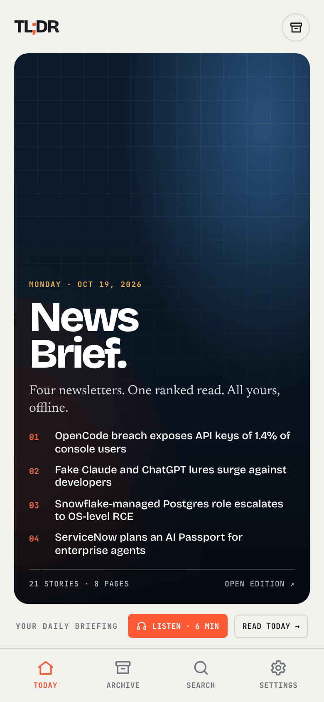
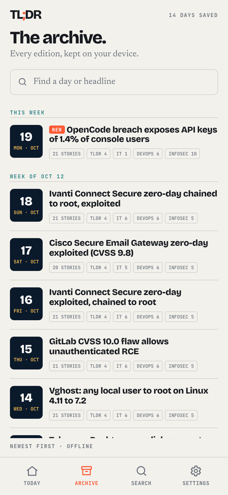
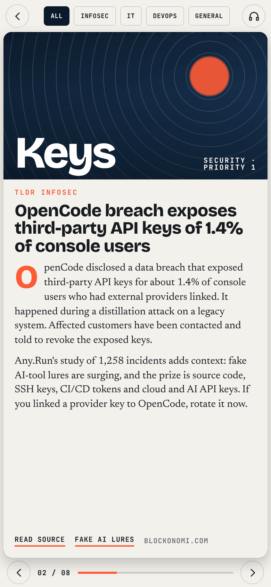
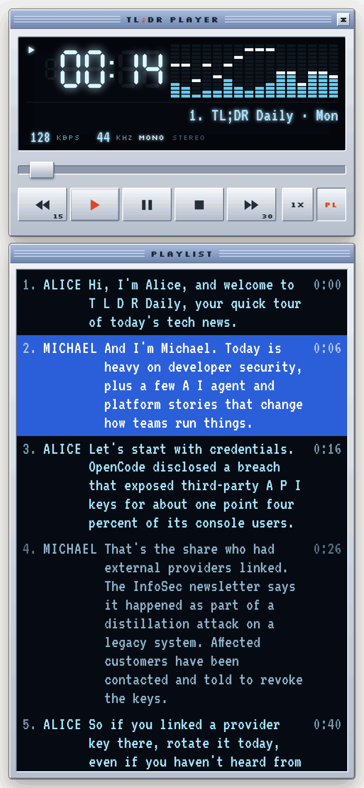
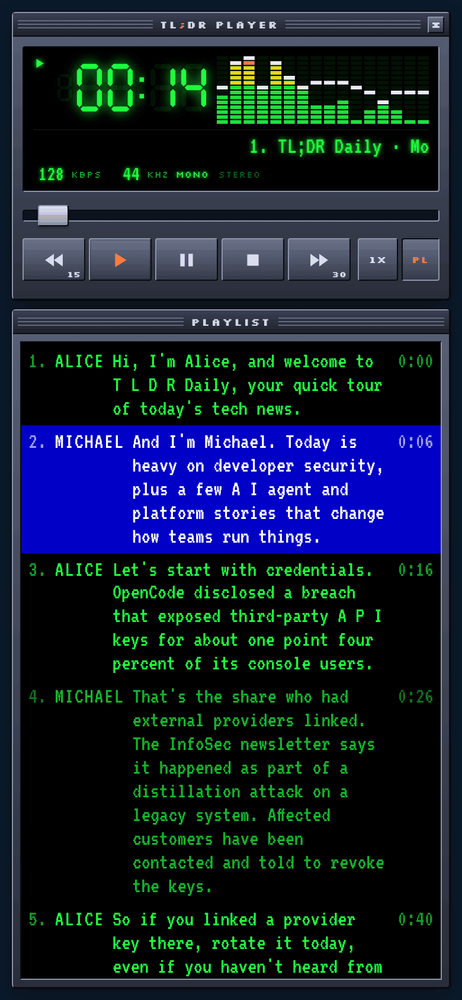
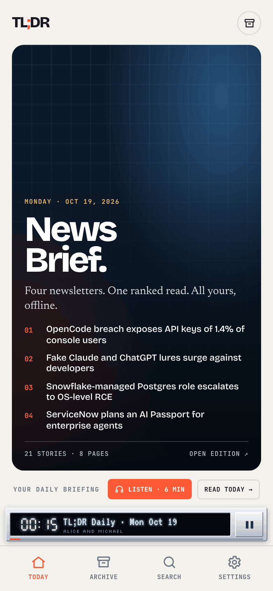
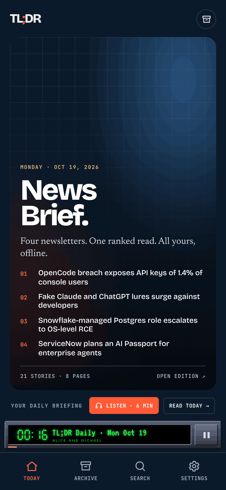

# TL;DR

Android app for the daily TLDR News Brief. Every edition from Oct 6 2026 is bundled, so it reads fully offline.
Screens: Today, Archive (day cards by week), Reader (binder page-flip with InfoSec / IT / DevOps / General filter), Search (with priority filter), Settings (light, dark, system).

- App name `TL;DR`, package `com.tldr.feed`, Capacitor 8, min Android 7.0 (API 24).
- `www/` is the whole app (plain HTML, CSS, JS). `android/` is the generated Capacitor project.
- `reference/` holds only `podcast-example-script.txt`, the model script the routine reads for the podcast.

## Screenshots

Phone width, light and dark. The player is a retro Winamp-style window with real spectrum bars, a 7-segment clock and the transcript as the playlist.

| Today | Archive | Reader |
|---|---|---|
|  |  |  |

| Player (light) | Player (dark) | Minimized (light) | Minimized (dark) |
|---|---|---|---|
|  |  |  |  |

The minimized player sits above the bottom bar. It keeps playing, shows the time and title, and has a pause button; tap it to open the full player again.

## Build the APK

Needs Node 22+, JDK 21 and the Android SDK (Android Studio installs it).

```
npm ci
npm run apk                                  # debug APK
# android/app/build/outputs/apk/debug/app-debug.apk
```

Or open the `android/` folder in Android Studio and press Run.
There is no CI: the repo has no GitHub Actions workflows, and the APK is built locally.

## Try the UI in a browser

```
python3 -m http.server 8765 -d www     # then open http://localhost:8765
```

## Feed: how new days reach the app

The app reads `feed/` from this public repo (raw GitHub URL, set as `FEED_BASE` in `www/js/app.js`).
On launch, when the app returns to the foreground after 30 minutes, and on pull-down or Settings > Refresh, it fetches `feed/index.json`, downloads days it does not have, validates them and caches them on the device. No rebuild is needed for new content. If the network or feed fails, it shows what is saved.

```
feed/index.json            {version, updated, editions:[{date, file, headline, counts, total, pages, hash}]}
feed/days/YYYY-MM-DD.json  {version:1, date, source:"gmail"|"fallback", counts, total, TOP:[[headline, page]], P:[pages, no cover]}

counts = {tldr, it, devops, infosec}: stories per newsletter. total = their sum. Both are always computed by the
publish script from the pages (incoming values are ignored). Days written before this field existed have none; the
app and the index derive them from the pages with the same rule (www/js/shared.js).
```

Publish a day (this is what the routine runs).

```
node scripts/publish-feed.js edition.json    # sanitize, lint, skip near-duplicates, write the day, rebuild the index
npm run feed:lint                            # lint the whole feed; run before every push
npm test                                     # tests for the scripts (temp folders only)
npm run feed:dedupe-report                   # how much of each day repeats the 5 days before it
git add feed && git commit -m "feed: YYYY-MM-DD" && git push
```

Links. A story link is kept as the email gave it, including TLDR short links (`https://links.tldrnewsletter.com/<code>`).
Everything else on the TLDR newsletter domain is dropped, because `a.tldrnewsletter.com` serves web-version and unsubscribe links that carry signed subscriber tokens. Referral, sponsor and job hosts are dropped too, `utm_*` and similar params are stripped, and http is upgraded to https.
A story left without a URL shows as plain text in the app. There is no search fallback and no invented link.
Short links are public once they are in this repo. Tapping one counts as a click for the newsletter, not as a person.

The linter fails on an email address, subscription or referral text, blocked hosts, short links with a query string, non-https URLs, counts that do not match the pages, bad structure or oversize text, and writes nothing on failure.

Duplicates. If 70 percent or more of an incoming edition's stories already appeared in the 5 days before its date (same URL, or headline word overlap of 0.6), `publish-feed.js` exits 3 and writes nothing, and `routine-publish.sh` reports "skipped duplicate" and exits 0. Re-publishing the same date still replaces that day. `FORCE_PUBLISH=1` bypasses the check.

Regenerate the offline seed bundled in the app after any feed change: `node scripts/build-seed.js` (writes `www/data/editions.json`).

One-off repair, already run if you are reading this after the backfill commit: `node scripts/backfill-links.js` restores TLDR short links that an earlier version of the sanitizer blanked, copying them from git history. It is a dry run unless you pass `--apply`, and it fetches nothing.

The daily routine publishes with `bash scripts/routine-publish.sh edition.json`. The routine's prompt is kept outside this repository.

## Podcast: the Listen button

A two-host recap (Alice and Michael) of the latest edition, 6 to 7 minutes, for the latest day only. Archive days have no podcast.

How it flows:
1. The routine writes a script (`HOST_A:` / `HOST_B:` lines) from the full emails, using `reference/podcast-example-script.txt` as the model.
2. `bash scripts/publish-podcast.sh script.txt --date YYYY-MM-DD` lints the script, makes the audio with Kokoro (`scripts/podcast/synth.py`, Alice = `af_heart` 70% + `af_bella` 30%, Michael = `am_michael` 60% + `am_adam` 40%, no cloud TTS), lints the audio, and force-pushes ONE commit with `latest.mp3` and `podcast.json` to the `podcast` branch. The branch is replaced every day, so audio never piles up in history.
   The delivery is shaped by `--style natural` (the default): each line is paced by what it is (questions and reactions a little quicker, action advice a little slower), pauses are short after a question and longer before a new topic, a short reaction can land slightly over the end of the previous line (`--overlap 0` turns that off), loudness is evened out and dead air is trimmed. `--style plain` is the old flat delivery. Voices are blends of Kokoro voice styles and can be changed with `--voice-a` and `--voice-b` (or the env vars `PODCAST_VOICE_A` and `PODCAST_VOICE_B`). The result is deterministic. Both hosts must sign off with their own name; the script lint enforces it.
3. The app reads `podcast.json` from `https://raw.githubusercontent.com/saratrajan/tldr-devsecops/podcast/`. The Listen button shows only when `podcast.json`'s date equals the latest edition's date.
4. Tapping Listen downloads the mp3 once, verifies size and hash, keeps one copy on the device (a new day replaces it), and plays it with a transcript that follows the audio. It plays offline after the first listen.
5. The player is drawn in a retro style, in CSS and SVG only. Light theme: silver body with an ice-blue LCD. Dark theme: classic dark metal with a green LCD. It has 7-segment time digits (tap them to switch between time played and time left), a scrolling title, kbps, kHz and mono indicators, a chunky seek slider, back 15 s, play, pause, stop and forward 30 s buttons (the × in the title bar closes it), and a playlist window that is the transcript (the PL button hides it). The spectrum analyzer is real: `synth.py` computes 16 bands at 10 frames per second from the finished audio and stores them in `podcast.json` (`spec`), so the app needs no live audio analysis.
6. Playback keeps going with the screen off: `@capgo/capacitor-media-session` runs an Android foreground service while audio plays and adds lock-screen controls.

`podcast.json`: `{version, date, title, hosts:{A,B}, file:"latest.mp3", seconds, bytes, bitrate, hash, words, segments:[{h:"A"|"B", t:"text", s:startSeconds}], specBands:16, specFps:10, spec:"<base64, frames x 16 bytes>"}`. The `spec` fields are optional; without them the analyzer shows a decorative animation.

Commands:
```
node scripts/lint-podcast-script.js script.txt          # length 700-1200 words, speakable text, no URLs or emails
NO_PUSH=1 bash scripts/publish-podcast.sh script.txt --date YYYY-MM-DD   # build and check, do not push
node scripts/lint-podcast.js podcast.json latest.mp3     # check a finished podcast
npm test                                                # includes the podcast scripts (uses a fast fake synthesizer)
python3 scripts/podcast/test_spectrum.py                # spectrum maths on synthetic audio (needs numpy)
```
Env: `PODCAST_BITRATE` (default 128k), `PODCAST_BRANCH` (default podcast). Edit `scripts/podcast/pronounce.json` when a word is read badly. The player fonts (Silkscreen and VT323, both OFL) are bundled in `www/fonts`.

Android notes. The foreground service needs `FOREGROUND_SERVICE_MEDIA_PLAYBACK` (declared in the manifest) on Android 14 and newer. On Android 13 and newer the lock-screen player appears only when notifications are allowed for the app (Settings, Apps, TL;DR, Notifications). The app shows a one-time tip about it. Audio keeps playing without that permission. Background playback has not been verified on a device yet.


Release signing is not set up; the debug APK installs fine for personal use.
